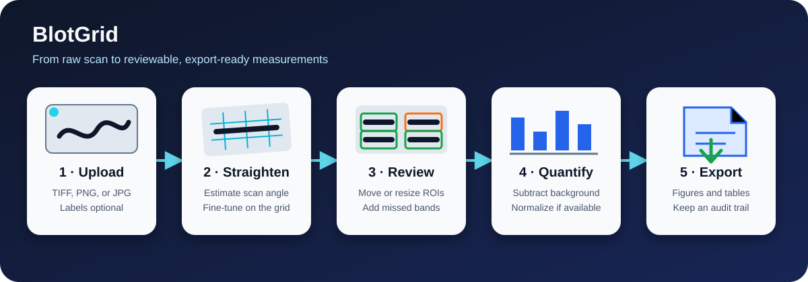

# BlotGrid

Local, privacy-first Western blot band detection and densitometry with raw-scan
recognition, visual scan straightening, editable ROIs, and optional control
normalization.

A local Streamlit app to quantify Western blot bands from an image, optionally
normalize each target against a housekeeping/loading control **in the same lane**,
aggregate replicates, and export publication-quality bar charts.

[Beginner tutorial](docs/BEGINNER_TUTORIAL.md) · [MIT license](LICENSE)



## Install & run

```bash
pip install -r requirements.txt          # once
python make_sample_blot.py               # optional: makes sample_blot.tif to try
streamlit run app.py
```

The app opens in your browser. No command line needed after launch.

## Workflow (tabs, left to right)

1. **Upload** — drop in one or more blot images (TIFF/PNG/JPG). Open
   **Straighten scan with alignment grid** to estimate skew automatically, tune
   the correction angle against a cyan square grid, and apply the corrected
   working image before detection. The guide grid is never written into the
   image. Local OCR reads
   printed target labels in top-to-bottom order and printed lane/condition labels
   in left-to-right order, then fills **Experiment setup** automatically. When a
   figure has target names but no printed lane names, the app infers the number of
   band columns and uses neutral names such as `Lane 1`, `Lane 2`; it never invents
   experimental conditions. A raw scan with no readable labels is inferred directly
   from its band grid and receives editable `Target 1`, `Target 2`, ... and `Lane 1`,
   `Lane 2`, ... names. Existing recognized names are retained when only part of the
   metadata is missing. Each image is one replicate. Add several to get real SEM/SD.
2. **ROIs** — the app automatically infers dark/light polarity, locates the lane
   and target-row centres, and draws an individual box around every detected band.
   Multiple bands in one target/lane (for example, a doublet) remain separate.
   Long panel borders and scanner streaks are masked before peak detection, and
   every candidate is checked for a locally connected, horizontal band component.
   Broad merged peaks are marked as unresolved rather than being split without
   evidence. A relaxed, cell-local recovery pass keeps probable faint bands
   active in orange for review; only cells with no usable signal become dashed
   grey fallbacks that are excluded until you review and enable them.
   Every box on a blot uses the same rectangle size for consistent measurement.
   The blot itself is an ImageJ-style editor: click a rectangle, drag inside it to
   move, or drag any of its eight handles to resize. Resizing is blot-locked, so it
   updates every rectangle and cannot selectively change one band's
   measurement area. Green boxes are accepted, red boxes are accepted loading
   controls, orange boxes need review, and dashed grey boxes are excluded.
   If automatic detection misses bands, **Add missed bands manually** lets you
   choose the target and lane and create one or several extra rectangles at once;
   drag each new rectangle over its band before quantifying.
   Arrow keys nudge the active ROI by one pixel; Alt + arrow keys
   resize all rectangles by one pixel. Numeric Width/Height controls and the
   X/Y table remain available for exact adjustments. An intensity-profile panel
   shows the vertical interval used for measurement. An evenly spaced manual grid
   is available as a fallback.
3. **Quantify** — runs densitometry (integrated density with background subtraction);
   flags saturated bands and non-positive signals. Profile-guided integration is
   the default: it retains the locked lane width but integrates only the dominant
   band's vertical peak interval. Classic full-rectangle integration remains
   available in the sidebar.
4. **Normalize** — when a recognized or manually selected control is available,
   `normalized(target, lane) = target(lane) / control(lane)`. If no usable control
   is found, normalization is skipped and the app carries the background-corrected
   net integrated intensity through replicates, plots, and exports instead.
   Optional fold-change vs a reference lane (reference = 1.0) is available after
   control normalization.
5. **Replicates** — pools blots by shared lane/condition labels → mean ± SD/SEM, N.
   `ci95` is the t-based 95% CI half-width, so it stays honest at the N=3 that
   most blots have. Optional t-test / ANOVA.
6. **Plot & Export** — bar chart per target with SEM/SD/CI error bars, data points,
   colorblind-safe palettes, fonts, legends, captions. Figure width/height are set
   in inches, which is what fixes the exported figure's real dimensions. Export
   PNG/TIFF/SVG/PDF at 150–600 DPI plus CSV/XLSX of the underlying data.

## Sizing the panels

Blots differ enormously in pixel size, so nothing is measured at a fixed scale:

- **Upload** — preview width and previews-per-row are adjustable, so a 4000 px
  scan and a 300 px crop both show at a size you choose.
- **ROIs → Display & panel size** — *Fit panel width* scales the blot to the
  panel, while *Zoom %* pins it to a fixed magnification (25–400%) and scrolls,
  which is what you want for pixel-accurate edges. Above 1:1 the image switches
  to unsmoothed pixels so band edges stay crisp instead of blurring. The blot
  panel's height is set by a slider or by dragging the panel's bottom-right
  corner, and the editor reports its true height back, so shrinking the panel
  really does reclaim the space. The blot and the controls can sit side by side
  with an adjustable width split, or stacked; the ROI table's height is separate.
- **Plot & Export** — a width-share slider trades space between the settings
  column and the chart preview.

The status line under the blot always states the image's pixel size and the
current zoom, so on-screen size is never confused with measured size. None of
these are stored in the project file: they are per-screen preferences, and
restoring someone else's project never rearranges your layout.

## The normalization model

A blot is a grid: **columns = lanes/samples**, **rows = probed targets**, with one
row marked as the loading control (GAPDH, β-actin, H3, H4, etc.). Each target band
is divided by the control band in the *same lane*. Example: with lanes WT/KO/Rescue
and rows Insig, Prmt9, GAPDH, `Insig_norm(WT) = Insig(WT)/GAPDH(WT)`, and so on.
The control is optional: unknown target names are never silently treated as a
control, and an experiment without one reports net integrated density in arbitrary
units rather than a misleading normalized value.

## Densitometry notes

- Handles 8-, 16- and 32-bit images; native range is preserved for measurement.
- Automatic polarity handles dark film bands and light chemiluminescent/
  fluorescent bands independently for each blot; an explicit override is available.
- Automatic detection uses background-corrected, per-lane intensity profiles so a
   strong band does not set one global threshold that hides faint bands. Detection
  sensitivity is adjustable, and all detected rectangles remain editable. Long
  panel borders, scanner streaks, and protein labels printed beside a blot are
  excluded automatically. Low-confidence, overlapping, and broad unresolved peaks
  are visibly flagged for review.
- Background methods: local median frame, rolling-ball, or a fixed per-pixel
  value you type in the sidebar (in signal units, i.e. after inversion).
- Reported value is **net integrated density** (background-subtracted).
- A band is flagged **saturated** when its pixels sit at the top of the native
  range, in whichever polarity the blot was acquired. Saturation breaks
  linearity — re-expose rather than quantify. Blank (zero-signal) background is
  not saturation and is not flagged.

## Saving a project

The sidebar's **Save project (.json)** button writes labels, ROI layouts,
replicate numbers and all measurement settings. **Load project** + **Restore
project** brings them back; re-upload the images (matched back to their layout by
file name) and re-run Quantify. Images are not embedded in the JSON.

## Layout

```
app.py                 Streamlit UI (6 tabs)
wblot/
  image_io.py          load images, signal polarity, saturation
  detection.py         automatic polarity, lanes, target rows and band rectangles
  label_ocr.py         local OCR for target/lane labels and lane-count inference
  densitometry.py      background subtraction, band measurement, lane profile
  normalization.py     per-lane control normalization, fold change
  stats.py             replicate aggregation, t-test / ANOVA
  plotting.py          publication bar chart builder
  project_io.py        save/load project JSON
make_sample_blot.py    generates a synthetic 3x3 demo blot
test_core.py           unit tests (run: python test_core.py)
```

## Tests

```bash
python test_core.py
```

Covers OCR label classification and unlabeled-lane inference, automatic dark/light
band detection (including a faint band and a doublet),
known-pixel integrated density, background subtraction (local and fixed), per-lane
normalization, fold-change, divide-by-zero guard, SEM/SD/CI aggregation, saturation
flagging in both polarities, 16-bit range handling, ROI edge clipping, and project
save/load round-tripping.

## License

BlotGrid is released under the [MIT License](LICENSE).

## Caveats

Densitometry accuracy depends on exposure being in the linear range and clean ROI
placement. This tool assists quantification; it does not replace good blot practice
(loading controls, biological replicates, avoiding saturation). Statistical tests
are convenience helpers — confirm the design fits your experiment.
