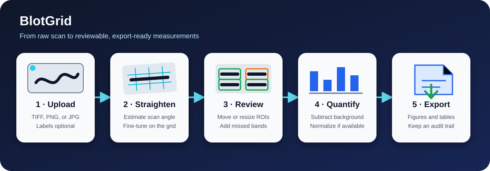

# BlotGrid beginner tutorial

This guide takes you from installation to an exported Western blot result. No
programming experience is required.



## 1. Install BlotGrid

Install Python 3.10, 3.11, or 3.12 from [python.org](https://www.python.org/downloads/).
On Windows, select **Add Python to PATH** during installation.

Download this repository, unzip it, and open a terminal inside the BlotGrid
folder. Install the required packages once:

```bash
python -m pip install -r requirements.txt
```

## 2. Start the app

Run:

```bash
python -m streamlit run app.py
```

BlotGrid should open in your web browser. If it does not, visit
`http://localhost:8501`. Your blot images stay on your computer.

## 3. Try the included sample first

Use `sample_blot.tif` for a quick practice run. It is a synthetic image, so it
is safe to experiment with.

1. Open **1 · Upload**.
2. Drop `sample_blot.tif` into the upload box.
3. Confirm that BlotGrid fills in `Target 1`, `Target 2`, and `Target 3`, plus
   three neutral lane names.

## 4. Straighten a tilted scan

Straightening should happen before reviewing band boxes.

1. Under the image, open **Straighten scan with alignment grid**.
2. Click **Estimate angle automatically**.
3. Check whether the bands follow the horizontal cyan grid lines.
4. If needed, adjust **Correction angle** in 0.1-degree steps. Positive values
   rotate counter-clockwise; negative values rotate clockwise.
5. Change **Grid spacing** only to make visual checking easier.
6. Click **Apply straightening**.

The cyan grid is only a guide; it is not added to the image or measurements.
BlotGrid always rotates from the untouched upload, so trying several angles does
not repeatedly blur the image. **Reset to uploaded image** restores the original.

## 5. Check names and loading control

Use the left panel to review:

- **Targets:** protein names from top to bottom.
- **Lanes / conditions:** samples from left to right.
- **Loading control:** choose the housekeeping protein only when one is present.

If the image has no readable labels, neutral names such as `Target 1` and
`Lane 1` are expected. Replace them with real experimental names when known.
If no control exists, choose **No control — intensity only**. BlotGrid will report
background-corrected intensity without pretending the values are normalized.

## 6. Review every band box

Open **2 · ROIs**.

- Green boxes are accepted bands.
- Red boxes are accepted loading-control bands.
- Orange boxes need review, often because a band is faint or overlapping.
- Dashed grey boxes are excluded fallbacks.

Click a box and drag it over the band. Drag a handle to change the shared box
size for the entire blot. Keeping one size makes measurements comparable.

If detection missed bands:

1. Open **Add missed bands manually**.
2. Choose the target and lane.
3. Enter how many boxes are missing.
4. Click **Add manual band box**.
5. Drag each new box over the correct band.

Do not include panel borders, labels, or neighbouring lanes inside a box.

## 7. Run densitometry

Open **3 · Quantify** and click **Run densitometry on all blots**.

Review warnings before continuing:

- **Saturated** means the exposure is clipped and is not reliable for
  quantitative comparison. Re-image the blot at a shorter exposure.
- **Non-positive signal** usually means the band is indistinguishable from its
  local background or the box needs repositioning.

## 8. Normalize only when appropriate

Open **4 · Normalize**.

When a loading control was selected, each target is divided by the control in
the same lane. Without a control, this step is skipped and BlotGrid carries the
net integrated intensity forward in arbitrary units.

## 9. Add replicates

Upload one image per replicate and give each a different **Replicate #**. Keep
target and lane names identical across comparable blots. In **5 · Replicates**,
choose SD, SEM, or 95% CI to summarize the repeated measurements.

Biological replicates are normally more informative than repeated measurements
of the same image.

## 10. Plot and export

Open **6 · Plot & Export** to adjust figure size, colors, error bars, labels, and
resolution. Export the figure and the underlying CSV or XLSX table together.
Keeping both makes the analysis easier to audit later.

## A reliable first-run checklist

- The scan is straight before band detection.
- Target and lane names match the image order.
- A loading control is selected only when it is truly present.
- Every active box covers one intended band and avoids borders or nearby lanes.
- Faint, overlapping, and manually added bands were visually checked.
- Saturated exposures are not used for quantitative conclusions.
- Exported figures are kept with their source data and project JSON.

## Common problems

### The command `streamlit` is not found

Use `python -m streamlit run app.py` instead.

### Automatic detection misses a band

Increase **Automatic detection sensitivity** slightly, run detection again, or
add a manual box in **2 · ROIs**. Always confirm the result visually.

### A panel border is selected

Move or exclude that box. A border should never be measured as a protein band.

### No normalized values appear

Check that a valid loading control was selected and that its band exists in the
same lane. Otherwise, intensity-only output is the correct behavior.

## Scientific note

BlotGrid assists with measurement; it cannot repair saturated exposures,
missing controls, inappropriate statistical designs, or non-linear imaging.
Keep the original scans and document every manual adjustment.
